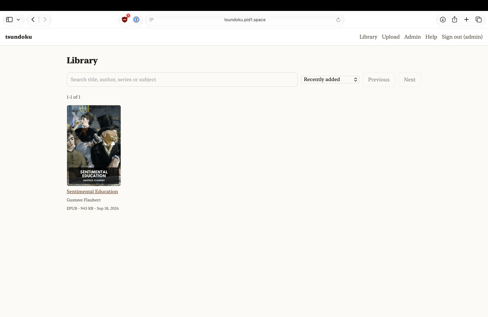

<p align="center"></p>

<p align="center">
  <a href="LICENSE"></a>
  <a href="https://github.com/pid1/tsundoku/actions/workflows/ci.yml"></a>
  <a href="https://developers.cloudflare.com/workers/platform/pricing/"></a>
</p>

<p align="center">
  <a href="https://pid1.github.io/tsundoku/">Website</a> •
  <a href="USAGE.md">Usage</a> •
  <a href="PLAN.md">Design</a> •
  <a href="docs/security.md">Security</a>
</p>

<p align="center"><em><strong>Tsundoku</strong> (積ん読, pronounced tsoon-doh-koo) is Japanese for buying books and letting them pile up unread.</em></p>

## What is tsundoku?

Tsundoku is a home for your ebooks. Upload them once, read them on any e-reader, and pick up on one device where you stopped on another. It runs on Cloudflare's free tier: one Worker, one R2 bucket and one D1 database.

It's built for a household, not the public. Every page but the sign-in page needs an account, and an administrator creates the accounts.

## From upload to reading

1. You drag a book onto the upload page. The title, authors and cover are read out of the file.
2. Your e-reader finds it in the catalog and downloads it.
3. KOReader saves your place to tsundoku as you read.
4. You open the same book on your phone, in the browser, at the same paragraph.

## What it does

- Serves an OPDS 2.0 catalog to KOReader, CrossPoint, Thorium and any other reader that speaks OPDS 2.0.
- Reads metadata and covers out of EPUB and CBZ files on upload, without downloading them.
- Syncs reading positions between devices with KOReader's own kosync protocol.
- Shows every device's position on every book, and whether they agree.
- Opens EPUB, CBZ, MOBI, AZW3 and FB2 in the browser, and syncs that position with KOReader too. Opening a book never overwrites your e-reader's place; only turning a page saves.
- Sets books in the publisher's fonts or Atkinson Hyperlegible Next, a choice saved to your account.
- Lets each device choose its own light or dark theme, text size, line spacing, line length (up to full width), one or two columns, top-and-bottom and side margins, and whether to show the status bar. Change them while reading from the **Aa** button, or on the Preferences page with a live preview.
- Keeps a book's own scripts from running, so an untrusted EPUB can't act as you.
- Stores up to roughly 2,000–5,000 EPUBs before it outgrows the free tier.

## Install

You need Node 24 with npm 11.10 or later, and a Cloudflare account. Pick one.

1. **The setup script.** It creates the bucket and the database, applies the migrations, sets the secrets and generates an admin password. It's safe to run again.

   ```bash
   git clone https://github.com/pid1/tsundoku && cd tsundoku
   npm install
   npx wrangler login
   ./scripts/setup.sh
   npm run deploy
   ```

   It prints the admin password at the end. Write it down: changing the `ADMIN_PASSWORD` secret later does not change it.

2. **By hand.** The same steps, one command at a time.

   <details>
   <summary>Manual setup</summary>

   ```bash
   npx wrangler r2 bucket create tsundoku
   npx wrangler d1 create tsundoku          # put the uuid in wrangler.toml as database_id
   npx wrangler d1 migrations apply tsundoku --remote

   openssl rand -base64 32 | npx wrangler secret put PEPPER
   openssl rand -base64 32 | npx wrangler secret put SESSION_KEY
   npx wrangler secret put ADMIN_USERNAME
   npx wrangler secret put ADMIN_PASSWORD

   npm run deploy
   ```

   </details>

Then give it a custom domain: uncomment the `[[routes]]` block in `wrangler.toml`. Some OPDS readers dislike `workers.dev` addresses, and sign-in is HTTP Basic, so it must be served over TLS.

### Agent instructions

Paste this into an AI agent that can run a shell and `wrangler`, to deploy tsundoku for you:

```text
Deploy tsundoku (https://github.com/pid1/tsundoku) to my Cloudflare account, on the domain DOMAIN. Ask me before any step that needs my password or a browser sign-in, and let me do those myself.

1. Clone the repository. Read README.md, USAGE.md and wrangler.toml in full.
2. Check that Node is 24 or later and npm is 11.10 or later. Run npm install.
3. Run npx wrangler login and wait for me to finish signing in.
4. Run ./scripts/setup.sh. When it prints the admin password, tell me to save it in my password manager. Never write it to a file, and never repeat it after that.
5. In wrangler.toml, uncomment the [[routes]] block and set the pattern to DOMAIN.
6. Run npm run deploy.
7. Confirm with: curl https://DOMAIN/healthcheck, which should answer {"state":"OK"}. Report the address and the admin username. Do not report the password.
```

Then sign in, create an account for each reader on the **Admin** page, and connect your devices. [USAGE.md](USAGE.md) has the settings for KOReader, Thorium and the rest.

## Connect a reader

| Reader | Where | Address |
|---|---|---|
| KOReader, catalog | Search → OPDS catalog → + | `https://DOMAIN/opds/2.0` |
| KOReader, progress sync | Tools → More tools → Progress sync → Custom sync server | `https://DOMAIN` |
| CrossPoint, Thorium, any OPDS 2.0 reader | Add an OPDS catalog | `https://DOMAIN/opds/2.0` |

The catalog is OPDS 2.0 only. Readers that only speak the older OPDS 1.2 can't use it. Sign in with the same account on every device, the web reader included. Positions are kept per account, so a device on another account never sees them. The running server has the same instructions at `/help.html`.

## Design principles

- **Free to run.** A household's library fits the free tier, and the free-tier arithmetic is written down in [PLAN.md](PLAN.md).
- **Readers' own protocols.** OPDS and kosync, so the reader you already use works without a plugin.
- **No build step.** TypeScript that wrangler bundles, and a UI of plain ES modules. No framework, no bundler.
- **Closed by default.** No public catalog, no self-signup, and no DRM or lending.
- **The pipeline shapes, renderers display.** The OPDS 2.0 catalog and the web UI are two renderings of one query.
- **Trade-offs written down.** Where the free tier forced a choice, like how passwords are stored, [docs/security.md](docs/security.md) says what was traded and why.

## License

BSD 3-Clause. Made by Jonathan Roemer. See [LICENSE](LICENSE).
