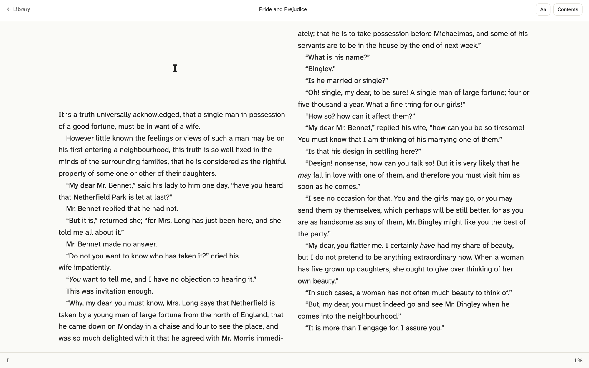
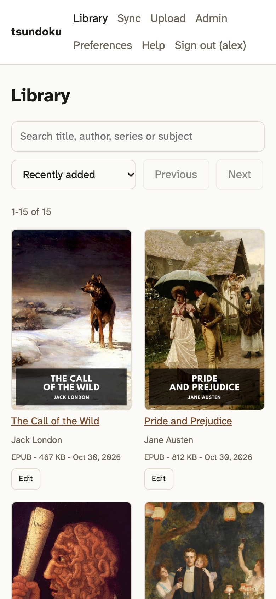
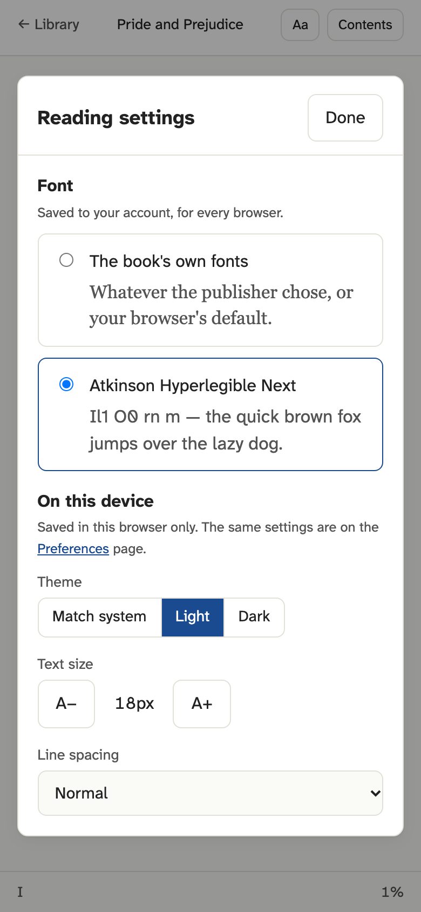
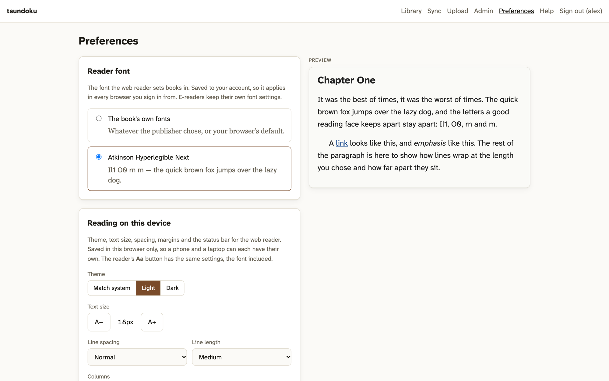
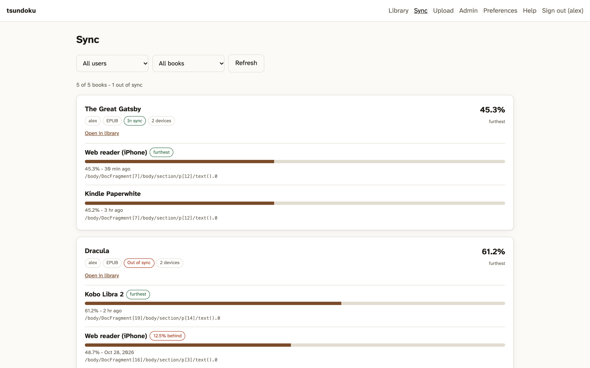
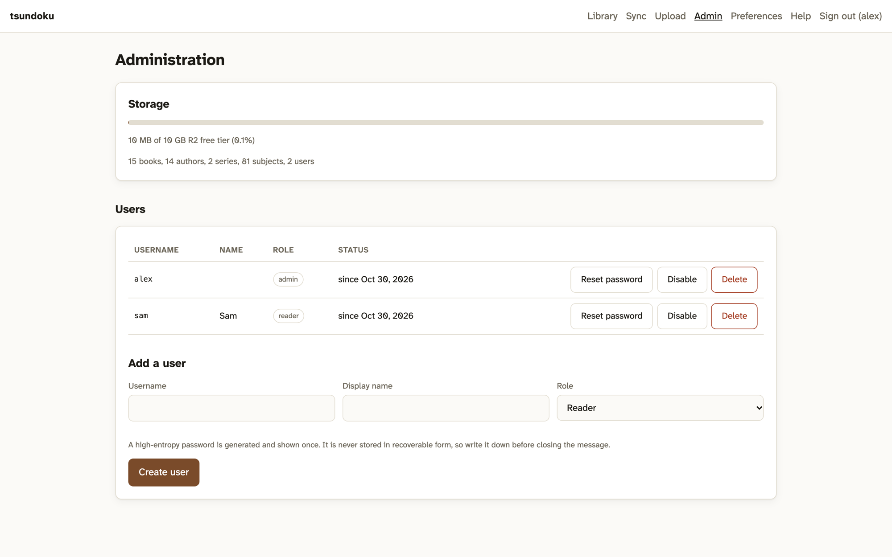

# Using tsundoku

[README.md](README.md) covers what tsundoku is and how to install it. This is how to run it day to day, connect readers, and read what the pages tell you. [PLAN.md](PLAN.md) has the design reasoning, and [docs/security.md](docs/security.md) the security model.

## Screens

The demo library is public-domain books from [Standard Ebooks](https://standardebooks.org).

<p align="center">
  
  <br><em>The web reader on a laptop: two columns, in Atkinson Hyperlegible Next.</em>
</p>

<p align="center">
  
  
  
  
  <br><em>On a phone: the library, the reader in light and dark, and the Aa panel.</em>
</p>

<p align="center">
  
  <br><em>Preferences: the font for your account, the reading settings for this device, and a live preview.</em>
</p>

<p align="center">
  
  <br><em>Sync: every device's position on every book, and whether they agree.</em>
</p>

<p align="center">
  
  <br><em>Administration: storage against the free tier, and the accounts.</em>
</p>

## Routine work

```bash
npm run deploy           # ./build.sh, then wrangler deploy (a push to main does this too)
npm run db:migrate       # apply new migrations to the remote database
npm run dev              # local dev server
npm run typecheck        # tsc --noEmit
npm test                 # vitest, inside workerd
./scripts/backup.sh      # dump the D1 tables
```

Neither deploy path applies migrations. A change that adds one needs `npm run db:migrate` before it merges.

## Connecting a reader

Replace `books.example.com` with your own address.

The catalog is OPDS 2.0 only, at `https://books.example.com/opds/2.0` (`/opds` redirects there). Readers that only speak OPDS 1.2 can't use it, and the old `/opds/1.2` address answers 410 Gone.

### KOReader: catalog

A recent KOReader speaks OPDS 2.0. **Search** → **OPDS catalog** → **+**

| Field | Value |
|---|---|
| Title | `tsundoku` |
| URL | `https://books.example.com/opds/2.0` |
| Username / Password | your account |

Long-press a book to download it.

### KOReader: progress sync

**Tools** → **More tools** → **Progress sync**

- **Custom sync server:** `https://books.example.com`, the base address with no path.
- Choose **Login**, not Register. Self-registration is off and is refused.
- Use **the same account on every device**, the web reader included. Positions are kept per account.
- Set **Document matching method** the same on every device. `binary`, the default, is the right choice. `filename` breaks the moment you rename a file.
- Turn on **Send document metadata** if you want titles shown beside positions.

`binary` matching identifies a book by hashing samples of the file itself. Two copies of the same book from different sources almost never hash the same, so download a book to every device from this catalog rather than sideloading a copy from elsewhere. Otherwise each copy keeps its own position.

### CrossPoint, Thorium and other readers

Any reader that speaks OPDS 2.0 takes `https://books.example.com/opds/2.0` with your username and password. CrossPoint and Thorium both do.

### By hand

```bash
curl -i https://books.example.com/opds/2.0                    # 401 + auth document
curl -u you:secret https://books.example.com/opds/2.0 | jq .
curl -u you:secret https://books.example.com/opds/2.0/new | jq .
curl https://books.example.com/healthcheck
```

## The Sync page

The **Sync** page shows every reading position, grouped by book and broken out per device, so you can see whether two devices agree.

- Each book lists its devices, furthest first, with how far behind the others are and when each last pushed.
- A book is **in sync** when its devices are within 0.5% of each other, **out of sync** when they are not, and **one device** when there is nothing to compare. The 0.5% allows for a device that re-renders the page it was handed and reports a slightly different number.
- Positions for books that are not in the library still appear, titled from the metadata KOReader sends. That's normal for a book you read on a device but never uploaded.
- Administrators see everyone and can filter by user. **Readers see only their own devices.** A reading position says what someone is reading and how far they have got, which is not something to show other readers.

kosync keeps one position per account per book, and the last device to push wins, so on its own it cannot say where each device is. The per-device positions are kept beside it in `progress_devices` (migration `0003`). The kosync routes are unchanged and still answer from `progress`.

## The web reader

Click a book's cover or title to read it in the browser. EPUB, CBZ, MOBI, AZW3 and FB2 open there. Anything else downloads instead. Each card's **Edit** button opens the metadata editor, which is also where the download link is.

- **It syncs with KOReader.** The web reader is one more kosync device. It saves to the same tables under the same document hash, in KOReader's own position format: an XPointer for EPUB and a page number for CBZ. Each browser shows on the Sync page as its own device, such as "Web reader (iPhone)". MOBI, AZW3 and FB2 positions stay in the browser, because KOReader could not read them back.
- **Positions are close, not exact.** KOReader's page structure is not the browser's, so a position carried from one to the other lands on the right paragraph and usually the right word. [`public/xpointer.js`](public/xpointer.js) explains why.
- **Opening a book never saves a position.** Only turning a page does. Otherwise just looking at a book on your phone would overwrite your e-reader's exact position with an approximation of it.
- **The font** is set on the **Preferences** page and saved to your account: the book's own fonts, or Atkinson Hyperlegible Next. The font files are served from `public/fonts` under the SIL Open Font License.
- **Theme, text size, line spacing, line length, margins and the status bar** are saved in each browser, so a phone and a laptop can differ. Top-and-bottom and side margins are set separately, in pixels, and default small so a phone screen goes to the text. Each column is capped at the line length and any width left over becomes margin, so choose **Full width** for the side margin to be the whole margin. **Columns** picks one or two; two needs a page wider than it is tall, so an upright phone always shows one. Change any of these, and the font, on the Preferences page, which has a live preview, or while reading from the **Aa** button. Both offer the same settings and save to the same place. Light is `#222222` on `#FAFAF7` and dark is `#E6E6E6` on `#121212`, both about 15:1. That's well past WCAG AAA but short of the 21:1 glare of pure black on white. The defaults are 18px, 1.6 line height and 65 characters a line.
- **A book's scripts never run.** Chapters render in `blob:` frames, which inherit the reader page's Content-Security-Policy from `public/_headers`. That policy admits only scripts served by this site.

Rendering is [foliate-js](https://github.com/johnfactotum/foliate-js), vendored at a pinned commit in `public/vendor/foliate-js` (its README there says which). It runs entirely in the browser: opening a book costs one `/content` request, and R2 downloads are free.

## Free tier

| Limit | Free plan | What it means here |
|---|---|---|
| R2 storage | 10 GB-month | **The first ceiling.** Roughly 2,000–5,000 EPUBs, or about 80 comics. Comics are what you outgrow it with. |
| Worker requests | 100,000 / day | Plenty for a household. The UI is static assets, which are free and unmetered. |
| Worker CPU | 10 ms / invocation | Shaped how passwords are stored. See [docs/security.md](docs/security.md). |
| Request body | 100 MB | Files over 95 MB upload in parts automatically. |
| R2 egress | Free | Why this is on R2 and not S3. |
| D1 | 5 GB, 5M row reads/day, 100k row writes/day | Nowhere near it. |

Figures read from Cloudflare's docs on 2026-09-18. Check them again before relying on them.

## Things that look like bugs but aren't

**Changing `ADMIN_PASSWORD` doesn't change the admin password.** That secret creates the first administrator on the first request after deploy, and only while there are no accounts. After that it is ignored. Change passwords on the **Admin** page.

**KOReader's Register button is refused.** It answers 402, as KOReader's reference sync server does. An administrator creates accounts. Set `ALLOW_KOSYNC_REGISTER = "1"` in `wrangler.toml` to open the endpoint, but it would create sync-only accounts with no catalog access.

**Covers and thumbnails are the same image.** Resizing needs Cloudflare Images, which isn't on the free tier. Readers scale covers themselves.

**A book can show its file name as its title.** PDF, MOBI and AZW3 have no metadata reader here, so fix the title in the editor. If reading a file's metadata fails, the upload still succeeds with the file name, and the card says why.

**Uploading the same file twice returns 409.** Duplicates are detected with R2's own MD5 checksum. Uploads over 95 MB go up in parts, which have no whole-file checksum, so they skip the check.

**A device's position doesn't reach the others.** Check that every device signs in with the same account and has the same copy of the book. The Sync page shows positions per account and per file, which usually makes the mismatch obvious.

## Layout

```
src/
  index.ts          fetch + scheduled handlers, admin seeding
  router.ts         path matching
  auth/             password verifiers, Basic, session cookies, isolate cache
  books/            zip reader, XML scanner, EPUB/CBZ metadata, KOReader hash
  db/queries.ts     every SQL statement
  http/             responses, ETags, byte ranges
  opds/             OPDS 2.0 serializer, auth document
  routes/           opds, content, api, kosync
  sync/             per-device sync status shaping, web reader positions
public/             the UI, served as static assets (free, unmetered)
  reader.*          the web reader; xpointer.js translates KOReader positions
  vendor/           foliate-js, vendored
  fonts/            reader fonts
migrations/         D1 schema
scripts/            setup, backup, reindex
test/unit/          vitest, running inside workerd
test/conformance/   checks against a deployed instance
```

The rule: **the pipeline shapes, renderers display.** An OPDS 2.0 feed and the UI's JSON are two renderings of one query result. If a renderer needs to work something out, the column is missing: add it to the row, not to the template.

## Testing

```bash
npm test                                    # unit, inside workerd
BASE_URL=https://books.example.com \
  TSUNDOKU_USER=you TSUNDOKU_PASS=secret \
  npm run conformance                       # against a deployment
```

Unit tests run in workerd rather than Node, because the ZIP reader depends on `DecompressionStream` and the kosync hash on Cloudflare's non-standard `crypto.subtle.digest("MD5")`. Testing those against Node polyfills would prove nothing.
